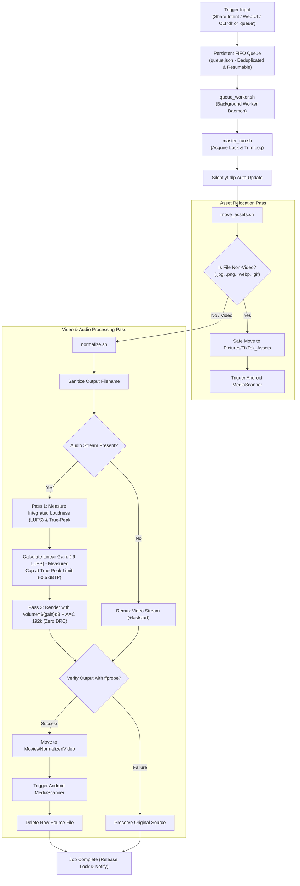

# Termux & PC Media Processing Pipeline

[](LICENSE)
[](#-storage--folder-architecture)
[](download.sh)
[](https://ffmpeg.org/)
[](#-mobile-friendly-web-ui)

An automated, cross-platform media ingestion and audio normalization pipeline. Built natively for **Android (Termux)** in internal shared storage (`/storage/emulated/0/Termux/`) and fully compatible with **Windows (PowerShell / CMD)** and **Linux / macOS**.

---

## 📌 Key Highlights

- **Linear Loudness Normalization (-9 LUFS):** Pure constant linear gain hitting **-9 LUFS** with **strictly zero dynamic range compression (DRC)**. Retains full musical dynamics, transient punch, and relative volume differences without any audible pumping or limiter breathing.
- **Safe True-Peak Protection:** Automatically parses inter-sample true-peak measurements (`input_tp`) and safely caps linear gain to prevent digital clipping (`MAX_TRUE_PEAK = -0.5 dBTP`) while strictly maintaining constant linear scaling.
- **Persistent FIFO Background Queue:** Accepts multiple URLs and local files, executes jobs sequentially in the background, prevents duplicates, records errors, and automatically resumes pending/interrupted jobs after reboot or task kill.
- **Mobile-Friendly Web UI:** Sleek, responsive web dashboard with dark-mode glassmorphism for queue tracking, one-tap batch processing, live log streaming, visual configuration editing, and one-click Git updates.
- **Android Share Integration:** Share any video link (TikTok, YouTube, Reels, etc.) or local video file directly to *Termux* from Android's native Share sheet to queue and normalize automatically.
- **Android Quick Settings Tile:** Access pipeline status and trigger normalization with one tap directly from your Android notification shade.
- **Automated Non-Video Asset Relocation:** Automatically detects image, sticker, and animation assets (`.jpg`, `.png`, `.gif`, `.webp`, `.heic`, `.svg`), relocates them safely to an asset library with collision prevention, and syncs them to Android's native MediaStore.
- **Codec-Aware Stream Optimization:** Bitstream copies compatible H.264/HEVC/MPEG-4 streams (`-c:v copy`) to eliminate generational quality loss and maximize processing speed.
- **Fail-Safe Ingestion:** Downloads and processed videos are verified for container validity, audio streams, and non-zero duration via `ffprobe` before the original raw file is deleted.
- **Safe Git Updates:** Update scripts seamlessly without overwriting user configuration (`config.env`), persistent queue state (`queue.json`), or custom local changes.

---

## 🏗️ Architecture & Pipeline Flow



---

## ⚡ 1-Click Installation

### Option A: Mobile (Android Termux)
Run this single command inside your Termux terminal:

```bash
curl -fsSL https://raw.githubusercontent.com/AnnaMorgrett/Termux/main/install.sh | bash
```
*Stores all scripts and user configuration in `/storage/emulated/0/Termux/` and registers global commands (`dl`, `tiktok`, `queue`, `webui`).*

### Option B: Windows (PowerShell)
Clone the repository and run the PowerShell installer:

```powershell
git clone https://github.com/AnnaMorgrett/Termux.git
cd Termux
.\install.ps1
```
*Creates native `dl.cmd`, `tiktok.cmd`, `queue.cmd`, and `webui.cmd` commands directly inside your Windows PATH.*

### Option C: Linux / macOS / Git Bash
Clone the repository and run the setup script:

```bash
git clone https://github.com/AnnaMorgrett/Termux.git
cd Termux
bash install.sh
```

---

## 🚀 Unified CLI Usage

The identical commands work across **Android, Windows PowerShell, and Linux**:

| Command | Description | Example |
| :--- | :--- | :--- |
| **`dl <URL>`** | Download URL via `yt-dlp` and immediately normalize to -9 LUFS | `dl "https://www.tiktok.com/@user/video/123"` |
| **`tiktok`** | Batch process all pending media in input directories | `tiktok` |
| **`queue add <U...>`** | Enqueue single/multiple URLs or files into persistent background queue | `queue add "https://youtu.be/..."` |
| **`queue list`** | Inspect pending, processing, completed, and failed jobs | `queue list pending` |
| **`queue status`** | Display queue counts and background worker state | `queue status` |
| **`queue retry-all`**| Reset all failed jobs back to pending | `queue retry-all` |
| **`webui open`** | Launch the mobile Web UI in your default browser | `webui open` |
| **`webui start`** | Start Web UI background daemon (default port `8080`) | `webui start` |

---

## 🌐 Mobile-Friendly Web UI

Launch the web dashboard at any time by running:
```bash
webui open
```
Or start it in the background:
```bash
webui start
```
*Accessible on your device at `http://127.0.0.1:8080` or across your local network via `http://<phone-ip>:8080`.*

### Web UI Features:
- **Live Status & Metrics:** Displays worker state (Idle / Processing / Paused), active job progress, pending counts, and device storage.
- **Batch Add & Paste:** Textarea supporting multiple URLs or file paths with one-tap clipboard paste.
- **Queue Manager:** Detailed job cards with status tags, timestamps, error descriptions, and retry/delete actions.
- **Audio & Tuning Controls:** Visual sliders for `TARGET_LUFS` (-9 LUFS default), `MAX_TRUE_PEAK` (-0.5 dBTP), and AAC bitrate.
- **Live Logs:** Real-time tailing of `media_processor_log.txt` with search filtering and auto-scroll.
- **Safe Git Updates:** Check and pull the latest commits without losing `config.env` or local modifications.

---

## 📱 Android Share Integration

You can queue videos directly from any Android app without opening Termux:
1. In TikTok, YouTube, Instagram, Facebook, or your browser, tap **Share** -> **Termux**.
2. Termux automatically runs `termux-url-opener`, adds the link to the persistent FIFO queue, displays a toast notification, and starts the background worker.
3. **Sharing Local Videos:** You can also share video files from your Gallery or Files app to Termux (`termux-file-editor`), which automatically imports and normalizes them.

---

## 🔔 Android Quick Settings Tile Setup

Access the media normalizer instantly from your Android pull-down notification shade:

### Option 1: Built-in Notification Shade Controller
Runs out of the box using Termux:API. Open the Web UI and tap **Pin Notification Shade Tile**, or run:
```bash
bash /storage/emulated/0/Termux/notification_tile.sh show
```
*Places a persistent control tile in your notification shade with **⚡ Normalize**, **🌐 Web UI**, and **⏯️ Worker** action buttons.*

### Option 2: Native Quick Settings Tile (MacroDroid / Tasker)
To add a native grid tile to your Android pull-down shade:
1. Open **MacroDroid** (or Tasker) and tap **Add Macro**.
2. **Trigger:** Quick Settings Tile (choose an available slot, name it *"Normalize Media"*).
3. **Action:** Applications -> Termux:Tasker (or Intent) -> choose:
   ```bash
   ~/.termux/tasker/media_normalize.sh
   ```
4. Pull down your Android notification shade, tap the edit (pencil) icon, and drag your new tile into the active panel.

### Option 3: Termux:Widget
Place the pre-configured shortcut on your home screen or widget launcher:
`~/.shortcuts/tasks/media_normalize.sh`

---

## 📁 Storage & Folder Architecture

The pipeline detects your operating system automatically and preserves your media directories:

| Component | Android (Termux) | PC (Windows / Linux / macOS) |
| :--- | :--- | :--- |
| **Scripts & Config** | `/storage/emulated/0/Termux/` | Cloned `Termux/` repository directory |
| **User Configuration**| `/storage/emulated/0/Termux/config.env` | `Termux/config.env` |
| **Queue State** | `/storage/emulated/0/Termux/queue.json` | `Termux/queue.json` |
| **Global CLI Binaries** | `$PREFIX/bin/` (`dl`, `tiktok`, `queue`, `webui`) | `WindowsApps/` (`*.cmd`) or `~/.local/bin/` |
| **TikTok Input** | `/storage/emulated/0/DCIM/TikTok/` | `~/TermuxMedia/DCIM/TikTok/` |
| **yt-dlp Ingest Queue** | `/storage/emulated/0/Download/yt-dlp/` | `~/TermuxMedia/Download/yt-dlp/` |
| **Relocated Assets** | `/storage/emulated/0/Pictures/TikTok_Assets/` | `~/TermuxMedia/Pictures/TikTok_Assets/` |
| **Final Videos** | `/storage/emulated/0/Movies/NormalizedVideo/` | `~/TermuxMedia/Movies/NormalizedVideo/` |
| **Central Debug Log** | `/storage/emulated/0/Termux/media_processor_log.txt` | `Termux/media_processor_log.txt` |

---

## 🎧 Audio Normalization Methodology

Standard normalization tools use single-pass compressors and limiters that cause audible pumping, alter dynamic balance, and squash audio transients.

This pipeline employs an **EBU R128 / ITU-R BS.1770 two-pass constant linear gain workflow**:

1. **Pass 1 (Measurement):**
   ```bash
   ffmpeg -i input.mp4 -af loudnorm=print_format=json -f null /dev/null
   ```
   Extracts integrated loudness (`input_i`) and true peak (`input_tp`) across the entire file.

2. **Linear Gain Calculation & True-Peak Protection:**
   $$\text{Raw Gain (dB)} = \text{TARGET\_LUFS} - \text{Measured\_LUFS}$$
   $$\text{Max Allowed Gain (dB)} = \text{MAX\_TRUE\_PEAK} - \text{Measured\_TP}$$
   $$\text{Linear Gain} = \min(\text{Raw Gain}, \text{Max Allowed Gain})$$
   *If applying raw gain would cause peaks to exceed `-0.5 dBTP`, gain is capped to prevent inter-sample distortion while retaining pure linear scaling (strictly zero DRC).*

3. **Pass 2 (Constant Linear Scaling):**
   ```bash
   ffmpeg -i input.mp4 -af "volume=${gain}dB" -c:a aac -b:a 192k output.mp4
   ```
   Adjusts the entire audio stream by a fixed coefficient, hitting **-9 LUFS** while keeping 100% of the original dynamic punch intact.

---

## ⚙️ Configuration & User Tuning (`config.env`)

User configuration is stored in `config.env` and is **never overwritten by Git updates**:

| Variable | Default | Description |
| :--- | :--- | :--- |
| `TARGET_LUFS` | `-9` | Target integrated loudness in LUFS (pure constant linear gain) |
| `MAX_TRUE_PEAK` | `-0.5` | True-peak ceiling in dBTP to prevent clipping without compression |
| `AUDIO_BITRATE` | `192k` | Audio bitrate for normalized AAC stream |
| `LOG_MAX_BYTES` | `2097152` | Maximum size of `media_processor_log.txt` before 50% rotation (2 MB) |
| `MEDIA_DIR` | Auto | Overrides root media folder (Android: `/storage/emulated/0`) |
| `WEB_UI_PORT` | `8080` | Port for the mobile Web UI |
| `WEB_UI_HOST` | `0.0.0.0`| Network interface for the Web UI (`0.0.0.0` allows LAN access) |
| `AUTO_UPDATE_YTDLP` | `true` | Automatically checks for yt-dlp updates during pipeline runs |

---

## 🔄 Updating from Git

To update to the latest improvements without losing your custom configuration or local modifications, run:
```bash
bash /storage/emulated/0/Termux/update.sh
```
Or click **Pull Updates from Git** in the Web UI.

---

## 🧩 Script Breakdown

- **[`download.sh`](download.sh)**: Dedicated `yt-dlp` download logic with sane output naming and timestamp flags.
- **[`move_assets.sh`](move_assets.sh)**: Non-video asset scanner and relocator with collision handling and MediaScanner broadcast.
- **[`normalize.sh`](normalize.sh)**: Video codec inspector, audio loudness calculator, linear gain renderer (-9 LUFS), true-peak limiter ceiling, and integrity verifier.
- **[`master_run.sh`](master_run.sh)**: Orchestration controller managing single-instance locks, log rotation, dependency updates, and sequential execution.
- **[`queue_manager.py`](queue_manager.py)**: Persistent FIFO queue engine with deduplication, atomic state saves, and safe recovery.
- **[`queue_worker.py`](queue_worker.py)**: Background worker daemon executing queued downloads and normalization.
- **[`queue_worker.sh`](queue_worker.sh)**: Shell service controller for the background worker (`start`, `stop`, `status`).
- **[`webui.py`](webui.py)**: High-performance, lightweight Python Web server & REST API.
- **[`webui.sh`](webui.sh)**: Daemon wrapper to start, stop, or open the mobile Web UI.
- **[`share_handler.sh`](share_handler.sh)**: Android Share intent handler for URLs and video files.
- **[`notification_tile.sh`](notification_tile.sh)**: Ongoing notification shade controller with interactive action buttons.
- **[`update.sh`](update.sh)**: Safe Git updater preserving user configuration.
- **[`install.sh`](install.sh)**: Automated installer for Android Termux and Linux/macOS.
- **[`install.ps1`](install.ps1)**: Automated installer for Windows PowerShell.

---

## 📄 License

This project is licensed under the [MIT License](LICENSE).
