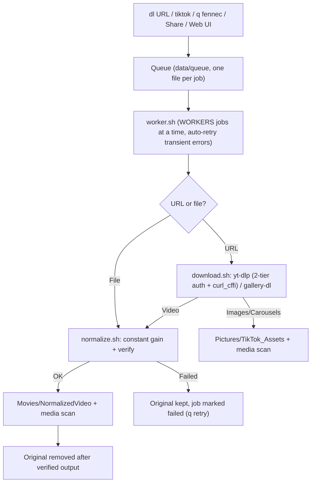

# Termux & PC Media Processing Pipeline

[](LICENSE)
[](#-storage--folder-architecture)
[](download.sh)
[](https://ffmpeg.org/)

An automated media ingestion and audio normalization pipeline with a persistent job queue. Built for **Android (Termux)**, also works on **Linux / macOS** and **Windows (PowerShell)**.

---

## 📌 Key Highlights

- **Constant-gain audio normalization (no compression):** one fixed gain for the whole file, no dynamic range compression, no pumping. Default mode `peak` puts the audio peak at -0.1 dB (`PEAK_PERCENT=100`). The older loudness mode (`NORM_MODE=lufs`, target -9 LUFS) is still available.
- **Background-first downloads:** `dl URL` queues immediately and returns; the worker downloads/processes in the background. `dl --wait URL` is available when synchronous completion is needed.
- **Parallel and fast:** `WORKERS` (default 2) processes several videos at the same time, and `FAST=1` cuts the peak-matching test encodes.
- **Fresh yt-dlp:** defaults to the upstream `master` Canary channel; choose `nightly` or `stable` in Web UI Settings.
- **Persistent queue:** every link or file becomes one job file in `data/queue`. First in, first out, no duplicates, and jobs resume after an interruption.
- **Web UI:** a local page (`127.0.0.1:8787`) with tabs for **Status**, **Queue**, **Fennec** history, **Logs**, and **Settings**.
- **Fennec browser sync (`q fennec` & `sync_cookies.sh`):** reads Fennec history (`places.sqlite`) and session cookies (`cookies.sqlite`) safely via root mount isolation (`su -mm`) and SQLite online backup, automatically stripping tracking parameters (`__cft__*`, `__tn__`, `fbclid`, `si`, `igsh`, `utm_*`) to deduplicate URLs.
- **Two-tier ingestion & image/carousel support:** tries unauthenticated downloads first before falling back to synced browser cookies, uses `curl_cffi` TLS impersonation for protected social endpoints, and routes image/carousel posts through `gallery-dl` into `Pictures/TikTok_Assets/`.
- **Share to Termux:** share a video link or a video file from any Android app straight into the queue.
- **Codec-aware & resilient:** compatible video streams are copied (`-c:v copy`), ByteVC2 TikTok streams are recovered cleanly, and transient network errors auto-retry in `worker.sh`.
- **Fail-safe:** the output is verified with `ffprobe` (and an audio decode check) before the original is deleted.
- **Non-video cleanup:** images, stickers and GIFs are moved to an assets folder.
- **Rolling log:** capped at 2 MB.

---

## 🏗️ Pipeline Flow



---

## ⚡ Installation

### Android (Termux) — fresh phone

1. Install **Termux** (from F-Droid or the Termux GitHub releases).
2. Paste this **one command** in Termux and press Enter:

```bash
termux-setup-storage; pkg update -y && pkg install -y git curl && until [ -w /storage/emulated/0 ]; do sleep 2; done && { [ -d /storage/emulated/0/Termux/.git ] || git clone https://github.com/AnnaMorgrett/Media-Pipeline.git /storage/emulated/0/Termux; } && bash /storage/emulated/0/Termux/install.sh
```

The storage popup appears first. Tap **Allow** while the packages install in the background. The installer adds `curl`, `ffmpeg`, `python`, `yt-dlp` and `termux-api`, all with `-y`. If something fails, it prints the failed step. Run the same command again to continue (it is safe to re-run).

3. Close Termux completely and open it again, then check:

```bash
q selftest
```

You should see `SELFTEST PASS`.

4. **Recommended:** also install the **Termux:API** app (same source as Termux). Without it, new files may not appear in the Gallery right away.
5. **Optional (social images & browser TLS impersonation):** install `gallery-dl` (for Instagram/X/TikTok image & carousel posts) and `curl_cffi` (for browser TLS fingerprint impersonation):

```bash
pip install -U gallery-dl curl_cffi
```

> If git says `detected dubious ownership`, run:
> `git config --global --add safe.directory /storage/emulated/0/Termux`

### Windows (PowerShell)

```powershell
git clone https://github.com/AnnaMorgrett/Media-Pipeline.git
cd Media-Pipeline
.\install.ps1
```

Creates `dl.cmd` and `tiktok.cmd` in your PATH.

### Linux / macOS / Git Bash

```bash
git clone https://github.com/AnnaMorgrett/Media-Pipeline.git
cd Media-Pipeline
bash install.sh
```

Needs `ffmpeg`, `ffprobe`, `python3` and `yt-dlp` in your PATH.

---

## 🚀 Usage

| Command | What it does |
| :--- | :--- |
| `dl "URL"` | Queue immediately and return; download/normalization continue in the background. Extra yt-dlp options can follow the URL. |
| `dl --wait "URL"` | Queue one link and keep this terminal attached until the worker drains the queue. |
| `tiktok` | Move assets, queue every video in the input folders, and run the whole queue. |
| `q add URL_OR_FILE...` | Add links or local video files to the queue and process in the background. |
| `q list` / `q stats` | Show jobs (`pending`, `running`, `done`, `failed`) / counts and worker state. |
| `q retry [ID\|all]` | Retry failed jobs. |
| `q update [--force]` | Update yt-dlp using the selected channel. `--force` bypasses the 6-hour update check interval. |
| `q stop` | Stop after the current job. |
| `q logs [N]` | Show the last N log lines. |
| `q fennec [N]` | List the last N media links from Fennec history (default 15) with tracking parameters stripped. |
| `q fennec add [IDX\|all]` | Sync cookies and queue listed Fennec history links (e.g. `1`, `1 3`, `1,3`, or `all`; default `1`). |
| `q ui open` | Start the Web UI and open it (also `q ui start\|stop\|status`). |
| `q percent [0-100]` | Show or set the audio peak target. `0` = -9.0 dB, `100` = -0.1 dB. |
| `q selftest` | Safe check that the queue works on this storage. |

Run `q` with no arguments to see the full list.

### Fennec Browser Integration (Rooted Android)

On rooted devices running **Fennec F-Droid**, the pipeline can read recent social/video links and session cookies directly without manual export:

- **CLI:** run `q fennec` to view recent deduplicated media URLs from Fennec's `places.sqlite`, then `q fennec add 1 3` (or `all`) to sync cookies and queue them.
- **Web UI:** open the **Fennec** tab in `q ui open` (`http://127.0.0.1:8787`) to browse the last 25 cleaned history items and queue any link with a single tap.
- **Cookie Sync (`sync_cookies.sh`):** extracts fresh Netscape-format cookies from Fennec's `cookies.sqlite` via `su -mm` and SQLite's online backup API (safe while Fennec is open) for authenticated `yt-dlp` / `gallery-dl` fallback passes.

### Share from Android

After install, share a video link (or a video file) to **Termux** from any app. It goes into the queue and is processed in the background. The handlers are `~/bin/termux-url-opener` and `~/bin/termux-file-editor`.

### Quick Settings tile (optional, needs Tasker)

`bash /storage/emulated/0/Termux/tasker_setup.sh` prepares Termux for Tasker and prints the remaining steps. Undo any time with `bash tasker_setup.sh --undo`.

---

## 🔄 Updating

```bash
git -C /storage/emulated/0/Termux pull --ff-only
```

```bash
bash /storage/emulated/0/Termux/shortcuts.sh
```

The second command refreshes the `dl`, `tiktok` and `q` commands. Your `data/` folder (queue) is not tracked by git, so updates do not touch it.

---

## 📁 Storage & Folder Architecture

| Component | Android (Termux) | PC (Windows / Linux / macOS) |
| :--- | :--- | :--- |
| **Scripts** | `/storage/emulated/0/Termux/` | The cloned `Media-Pipeline/` folder |
| **Commands** | `$PREFIX/bin/` (`dl`, `tiktok`, `q`) | `WindowsApps/` or `~/.local/bin/` |
| **Queue data** | `/storage/emulated/0/Termux/data/queue/` | `<repo>/data/queue/` |
| **TikTok input** | `/storage/emulated/0/DCIM/TikTok/` | `~/TermuxMedia/DCIM/TikTok/` |
| **yt-dlp input** | `/storage/emulated/0/Download/yt-dlp/` | `~/TermuxMedia/Download/yt-dlp/` |
| **Relocated assets** | `/storage/emulated/0/Pictures/TikTok_Assets/` | `~/TermuxMedia/Pictures/TikTok_Assets/` |
| **Final videos** | `/storage/emulated/0/Movies/NormalizedVideo/` | `~/TermuxMedia/Movies/NormalizedVideo/` |
| **Log** | `/storage/emulated/0/Termux/media_processor_log.txt` | `<repo>/media_processor_log.txt` |

Override the root media folder with `MEDIA_DIR`:

- **Bash:** `export MEDIA_DIR="/path/to/custom/media"`
- **PowerShell:** `$env:MEDIA_DIR = "D:\CustomMedia"`

---

## 🎧 Audio Normalization

Compressors and limiters make quiet sounds louder but cause pumping and squash transients. This pipeline only applies **one constant gain** to the whole audio stream.

- **`NORM_MODE=peak` (default):** measure the audio peak, then apply the gain that puts the peak at the target. Target = `-9 + 8.9 × PEAK_PERCENT / 100` dB. Default `PEAK_PERCENT=100` gives -0.1 dB.
- **`NORM_MODE=lufs`:** measure integrated loudness (EBU R128 / ITU-R BS.1770), then apply `TARGET_LUFS - measured` dB. The gain is capped so true peaks stay below `TRUE_PEAK_CEILING`.

Output audio is AAC (`AUDIO_BITRATE`, default 192k).

**Speed vs accuracy (`peak` mode):** AAC cannot land exactly on a peak, so the script makes test encodes (up to 24 per video) until the real peak is within `PEAK_TOLERANCE` below the target. The default 0.05 dB is very strict and can be slow. For faster runs use `FAST=1`; the peak still never goes above the target.

```bash
FAST=1 WORKERS=3 tiktok
```

You can also set `FAST` and `WORKERS` in the Web UI settings (`q ui open`) so they stay for every run.

---

## ⚙️ Environment Variables

Change behavior without editing scripts (for example `PEAK_PERCENT=80 tiktok`):

| Variable | Default | Description |
| :--- | :--- | :--- |
| `NORM_MODE` | `peak` | `peak` or `lufs` |
| `PEAK_PERCENT` | `100` | 0-100, target peak for `peak` mode (0 = -9.0 dB, 100 = -0.1 dB) |
| `TARGET_LUFS` | `-9` | Target loudness for `lufs` mode |
| `TRUE_PEAK_CEILING` | `-1.0` | Max true peak (dBTP) after gain, `lufs` mode |
| `WORKERS` | `2` | Videos processed at the same time (1-4). Use 1 on a weak or hot phone |
| `YT_DLP_CHANNEL` | `master` | `master` (Canary), `nightly`, or `stable` update channel. |
| `FAST` | `0` | `1` = accept a peak up to 0.3 dB below target (fallback 0.6) instead of 0.05 dB: fewer test encodes, much faster. The peak never goes above the target |
| `PEAK_TOLERANCE` | `0.05` (`0.30` with FAST) | How far BELOW the target the peak may land (never above). Bigger = faster, see below |
| `PEAK_FALLBACK_TOLERANCE` | `0.30` (`0.60` with FAST) | Wider limit accepted (flagged APPROXIMATE) when AAC cannot hit the strict window. `0` = refuse instead |
| `VERIFY_DECODE` | `1` | `1` = also decode the output audio once as a check |
| `AUDIO_BITRATE` | `192k` | AAC bitrate |
| `LOG_MAX_BYTES` | `2097152` | Log size limit before the oldest half is dropped |
| `MEDIA_DIR` | auto | Root media folder |

---

## 🧪 Tests

Needs `ffmpeg` and `python3`. Tests only use a temp folder.

```bash
for t in tests/s1a_test.sh tests/s1b_test.sh tests/s1c_test.sh tests/s1d_lock_test.sh tests/s3_test.sh tests/s5_peak_test.sh tests/s6_parallel_test.sh; do bash "$t" | tail -1; done
python3 tests/s2_test.py | tail -1
```

---

## 🧩 Script Breakdown

- **`install.sh` / `install.ps1`**: installers (Termux and Linux/macOS / Windows).
- **`shortcuts.sh`**: creates `dl`, `tiktok`, `q`, the share handlers and the Tasker scripts. Safe to re-run.
- **`q.sh` + `qctl.py`**: the `q` command (including `q fennec`) and the persistent queue engine.
- **`sync_cookies.sh`**: root (`su -mm`) SQLite online-backup extractor that exports Fennec session cookies (`cookies.sqlite`) to Netscape format.
- **`worker.sh`**: runs queued jobs in order (`WORKERS` at a time) with automatic retry backoff for transient network failures.
- **`master_run.sh`**: the `tiktok` command: checks the configured yt-dlp channel, moves assets, queues folder videos, runs the worker.
- **`update_yt_dlp.sh`**: installs/updates the selected yt-dlp release channel with a 6-hour check interval.
- **`download.sh`**: two-tier `yt-dlp` download logic (unauthenticated first, cookie fallback second), `curl_cffi` TLS impersonation, and `gallery-dl` image/carousel routing.
- **`normalize.sh`**: codec check, ByteVC2 recovery, gain calculation, render and verification.
- **`move_assets.sh`**: moves non-video files to the assets folder.
- **`scan_lib.sh`**: Android media scan helper. **`config_lib.sh`**: safe config loader.
- **`webui.py` + `webui.html`**: the Web UI (Python standard library only) with Status, Queue, Fennec history, Logs, and Settings tabs.
- **`share_handler.sh`**, **`tasker_setup.sh`**: Android Share and Tasker support.

---

## 📄 License

MIT. See [LICENSE](LICENSE).
