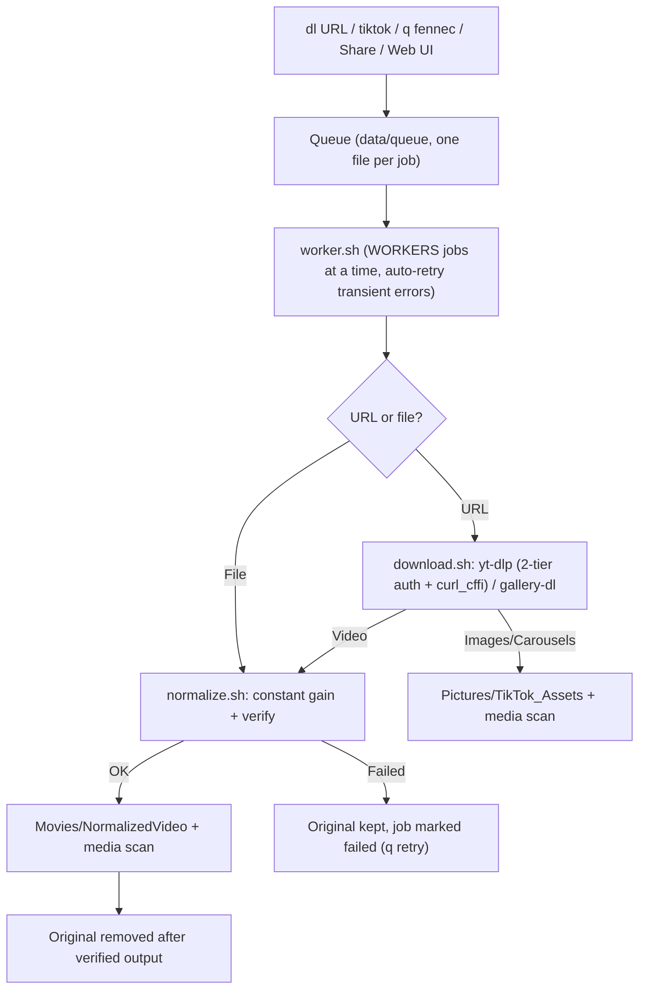

# Termux & PC Media Processing Pipeline

[](LICENSE)
[](#-storage--folder-architecture)
[](download.sh)
[](https://ffmpeg.org/)

An automated media ingestion and audio normalization pipeline with a persistent job queue. Built for **Android (Termux)** (both rooted and rootless/Shizuku setups), and also works on **Linux / macOS** and **Windows (PowerShell)**.

---

## 📌 Key Highlights

- **Constant-gain audio normalization (no compression):** applies one fixed linear gain across the entire file—no dynamic range compression and no pumping. Default mode `peak` targets `-0.1 dB` (`PEAK_PERCENT=100`); for stricter AAC encoding headroom, use `PEAK_PERCENT=90` (`-0.99 dB`) with `FAST=1`, or `NORM_MODE=lufs` (`TARGET_LUFS=-9`, `TRUE_PEAK_CEILING=-1.0`).
- **Background-first downloads:** `dl URL` queues immediately and returns while the background worker downloads and normalizes. Use `dl --wait URL` when synchronous completion is needed.
- **Parallel and fast:** `WORKERS` (default `2`, configurable `1–4`) processes multiple videos concurrently, and `FAST=1` reduces peak-matching test encodes.
- **Fresh yt-dlp:** defaults to the upstream `master` Canary channel; switch between `master`, `nightly`, or `stable` in Web UI Settings.
- **Persistent queue:** every link or file becomes one atomic job file in `data/queue` (FIFO, deduplicated, and resumable after interruptions).
- **Web UI:** local dashboard (`127.0.0.1:8787`) with tabs for **Status**, **Queue**, **Fennec**, **Logs**, and **Settings**.
- **Fennec browser sync (`q fennec` & `sync_cookies.sh`):** on rooted Android, reads Fennec history (`places.sqlite`) and session cookies (`cookies.sqlite`) safely via `su -mm` and SQLite online backup while stripping tracking parameters (`__cft__*`, `__tn__`, `fbclid`, `si`, `igsh`, `utm_*`). On unrooted Android, `sync_cookies.sh` imports an exported `Download/cookies.txt` into `data/cookies.txt`.
- **Two-tier ingestion & image/carousel support:** tries unauthenticated downloads first before falling back to synced browser cookies, uses `curl_cffi` TLS impersonation for protected social endpoints, and routes image/carousel posts through `gallery-dl` into `Pictures/TikTok_Assets/`.
- **Share to Termux:** share any video link or local video file from any Android app straight into the queue.
- **Codec-aware & resilient:** compatible video streams are copied untouched (`-c:v copy`), live ByteVC2 (`bvc2`) TikTok files are automatically re-downloaded as standard H.264 when available, and transient network errors auto-retry in `worker.sh`.
- **Fail-safe & Gallery-aware:** output is verified with `ffprobe` (plus an optional audio decode pass) before removing the source file, and Android MediaStore scanning works via Termux:API, Shizuku (`rish`), or root (`su`).
- **Non-video cleanup & rolling log:** images, stickers, and GIFs are relocated to an assets folder, and the pipeline log is capped at 2 MB.

---

## 🏗️ Pipeline Flow



---

## ⚡ Installation

### Android (Termux) — fresh phone

**Step 1 — Install Termux**
Install **Termux** from F-Droid or the official Termux GitHub releases.

**Step 2 — Run the bootstrap installer**
Paste this command in Termux and tap **Allow** when the storage permission prompt appears:

```bash
termux-setup-storage; pkg update -y && pkg install -y git curl && until [ -w /storage/emulated/0 ]; do sleep 2; done && { [ -d /storage/emulated/0/Termux/.git ] || git clone [https://github.com/AnnaMorgrett/Media-Pipeline.git](https://github.com/AnnaMorgrett/Media-Pipeline.git) /storage/emulated/0/Termux; } && bash /storage/emulated/0/Termux/install.sh
```

The installer installs `curl`, `ffmpeg`, `python`, `yt-dlp`, and `termux-api` with `-y`. It is idempotent and safe to re-run if interrupted.

**Step 3 — Restart Termux and verify the queue**
Close Termux completely, reopen it, and run:

```bash
q selftest
```

You should see `SELFTEST PASS`.

**Step 4 — Install Termux:API (recommended)**
Install the **Termux:API** companion app (from the same source as Termux) or configure Shizuku (`rish`) so newly processed media appears immediately in your Android Gallery.

**Step 5 — Install optional image & browser TLS packages**
Install `gallery-dl` (for Instagram/X/TikTok image and carousel posts) and `curl_cffi` (for browser TLS fingerprint impersonation):

```bash
pip install -U gallery-dl "curl-cffi>=0.17.0"
```

If Git reports `detected dubious ownership` on `/storage/emulated/0/Termux`, whitelist the directory once:

```bash
git config --global --add safe.directory /storage/emulated/0/Termux
```

### Windows (PowerShell)

```powershell
git clone [https://github.com/AnnaMorgrett/Media-Pipeline.git](https://github.com/AnnaMorgrett/Media-Pipeline.git)
cd Media-Pipeline
.\install.ps1
```

Creates `dl.cmd` and `tiktok.cmd` in your `PATH`.

### Linux / macOS / Git Bash

```bash
git clone [https://github.com/AnnaMorgrett/Media-Pipeline.git](https://github.com/AnnaMorgrett/Media-Pipeline.git)
cd Media-Pipeline
bash install.sh
```

Requires `ffmpeg`, `ffprobe`, `python3`, and `yt-dlp` in your `PATH`.

---

## 🚀 Usage

| Command | What it does |
| :--- | :--- |
| `dl "URL"` | Queue immediately and return; download and normalization continue in the background. Extra `yt-dlp` options can follow the URL. |
| `dl --wait "URL"` | Queue one link and keep the terminal attached until the worker drains the queue. |
| `tiktok` | Move non-video assets, queue every video in the input folders, and run the queue. |
| `q add URL_OR_FILE...` | Add links or local video files to the queue and start processing in the background. |
| `q list` / `q stats` | Show jobs (`pending`, `running`, `done`, `failed`) or queue counts and worker state. |
| `q retry [ID\|all]` | Retry one failed job ID or all failed jobs. |
| `q update [--force]` | Update `yt-dlp` on the configured channel (`--force` bypasses the 6-hour check interval). |
| `q stop` | Signal the worker to stop cleanly after finishing its current job. |
| `q logs [N]` | Show the last `N` log lines. |
| `q fennec [N]` | List the last `N` deduplicated media links from Fennec history (default 15, rooted Android). |
| `q fennec add [IDX\|all]` | Sync cookies and queue listed Fennec history links (e.g. `1`, `1 3`, `1,3`, or `all`; default `1`). |
| `q ui open` | Start the Web UI and open it in your browser (also `q ui start\|stop\|status`). |
| `q percent [0-100]` | Show or set the audio peak target (`0` = `-9.0 dB`, `100` = `-0.1 dB`). |
| `q selftest` | Run a safe storage check verifying atomic writes, locking, and queue operations. |

Run `q` with no arguments to see all subcommands.

### Fennec Browser & Cookie Integration

Public TikTok, Instagram, and X videos download without cookies. Cookies are only needed for login-walled, age-gated, or friends-only posts:

- **Rooted Android (automatic):** `q fennec` reads recent deduplicated media URLs from Fennec's `places.sqlite`, and `sync_cookies.sh` extracts Netscape-format cookies from Fennec's `cookies.sqlite` via `su -mm` and SQLite's online backup API (safe while Fennec is open).
- **Unrooted Android (manual export):** install the **Get cookies.txt LOCALLY** extension in Fennec, export `cookies.txt` to `/storage/emulated/0/Download/cookies.txt`, and move it into `/storage/emulated/0/Termux/data/cookies.txt` (or run `bash sync_cookies.sh`).

### Share from Android

After installation, share any video link or local video file to **Termux** from any Android app to enqueue it in the background via `~/bin/termux-url-opener` and `~/bin/termux-file-editor`.

### Quick Settings Tile (optional, requires Tasker)

Run `bash /storage/emulated/0/Termux/tasker_setup.sh` to prepare Termux for Tasker and print the setup steps. Revert any time with `bash tasker_setup.sh --undo`.

---

## 🔄 Updating

```bash
git -C /storage/emulated/0/Termux pull --ff-only
bash /storage/emulated/0/Termux/shortcuts.sh
```

`shortcuts.sh` refreshes the `dl`, `tiktok`, and `q` wrappers. Your `data/` directory (queue state, config, logs, and cookies) is git-ignored and untouched by updates.

---

## 📁 Storage & Folder Architecture

| Component | Android (Termux) | PC (Windows / Linux / macOS) |
| :--- | :--- | :--- |
| **Scripts** | `/storage/emulated/0/Termux/` | The cloned `Media-Pipeline/` folder |
| **Commands** | `$PREFIX/bin/` (`dl`, `tiktok`, `q`) | `WindowsApps/` or `~/.local/bin/` |
| **Queue data** | `/storage/emulated/0/Termux/data/queue/` | `<repo>/data/queue/` |
| **TikTok input** | `/storage/emulated/0/DCIM/TikTok/` | `~/TermuxMedia/DCIM/TikTok/` |
| **yt-dlp input** | `/storage/emulated/0/Download/yt-dlp/` | `~/TermuxMedia/Download/yt-dlp/` |
| **Relocated assets** | `/storage/emulated/0/Pictures/TikTok_Assets/` | `~/TermuxMedia/Pictures/TikTok_Assets/` |
| **Final videos** | `/storage/emulated/0/Movies/NormalizedVideo/` | `~/TermuxMedia/Movies/NormalizedVideo/` |
| **Log** | `/storage/emulated/0/Termux/media_processor_log.txt` | `<repo>/media_processor_log.txt` |

Override the root media directory with `MEDIA_DIR`:

- **Bash:** `export MEDIA_DIR="/path/to/custom/media"`
- **PowerShell:** `$env:MEDIA_DIR = "D:\CustomMedia"`

---

## 🎧 Audio Normalization & ByteVC2 Handling

Compressors and limiters raise quiet audio at the cost of pumping and squashed transients. This pipeline applies **one constant linear gain** across the entire audio stream and copies the video stream losslessly (`-c:v copy`).

- **`NORM_MODE=peak` (default):** measures the audio peak and applies gain to reach `-9 + 8.9 × PEAK_PERCENT / 100` dB (`PEAK_PERCENT=100` targets `-0.1 dB`; `PEAK_PERCENT=90` targets `-0.99 dB`).
- **`NORM_MODE=lufs`:** measures integrated loudness (EBU R128 / ITU-R BS.1770) and applies `TARGET_LUFS - measured` dB, capped so true peaks stay below `TRUE_PEAK_CEILING`.

**Speed vs. precision (`peak` mode):** AAC re-encoding shifts sample peaks slightly, so `normalize.sh` runs calibration passes (up to 24 per file) until the encoded peak lands within `PEAK_TOLERANCE` below the target. On tracks with sharp transients at `PEAK_PERCENT=100` (`-0.1 dB`), AAC quantization can overshoot and miss the strict `0.05 dB` window; setting `PEAK_PERCENT=90` with `FAST=1` (or switching to `NORM_MODE=lufs` at `-9 LUFS` / `-1.0 dBTP`) prevents overshoot failures:

```bash
FAST=1 WORKERS=4 tiktok
```

**ByteVC2 (`bvc2`) TikTok files:** Videos saved via the TikTok app's built-in "Save video" button sometimes use ByteDance's proprietary `bvc2` codec, which upstream `ffmpeg` cannot decode. `normalize.sh` detects `bvc2` via `ffprobe` and automatically re-downloads a standard H.264 copy via `yt-dlp` when the post is still live on TikTok. (If the post has already been deleted from TikTok, move the local `bvc2` file out of `DCIM/TikTok/` or transcode it in CapCut / a `ffmpeg-bvc2` build.)

---

## ⚙️ Environment Variables

Override settings per run (e.g. `PEAK_PERCENT=90 FAST=1 tiktok`) or persist them in `data/config.conf` / Web UI Settings (`q ui open`):

| Variable | Default | Description |
| :--- | :--- | :--- |
| `NORM_MODE` | `peak` | `peak` or `lufs` |
| `PEAK_PERCENT` | `100` | `0–100` target peak in `peak` mode (`0` = `-9.0 dB`, `90` = `-0.99 dB`, `100` = `-0.1 dB`) |
| `TARGET_LUFS` | `-9` | Target integrated loudness in `lufs` mode |
| `TRUE_PEAK_CEILING` | `-1.0` | Maximum true peak (dBTP) after gain in `lufs` mode |
| `WORKERS` | `2` | Concurrent worker slots (`1–4`). Use `4` on flagship SoCs or `1` on thermally constrained devices |
| `YT_DLP_CHANNEL` | `master` | `master` (Canary), `nightly`, or `stable` update channel |
| `FAST` | `0` | `1` = allow peaks up to `0.30 dB` below target (`0.60 dB` fallback) instead of `0.05 dB` for faster encoding |
| `PEAK_TOLERANCE` | `0.05` (`0.30` with `FAST=1`) | Strict window below the target peak |
| `PEAK_FALLBACK_TOLERANCE` | `0.30` (`0.60` with `FAST=1`) | Fallback window (flagged `APPROXIMATE`) when AAC cannot hit the strict window (`0` = fail instead) |
| `VERIFY_DECODE` | `1` | `1` = decode the encoded output audio stream once to verify frame integrity |
| `AUDIO_BITRATE` | `192k` | AAC-LC output bitrate (e.g. `192k` or `256k`) |
| `LOG_MAX_BYTES` | `2097152` | Log size limit in bytes before trimming the oldest half |
| `MEDIA_DIR` | auto | Root media directory override |

---

## 🧪 Tests

Requires `ffmpeg` and `python3` (runs inside isolated temporary directories):

```bash
for t in tests/s1a_test.sh tests/s1b_test.sh tests/s1c_test.sh tests/s1d_lock_test.sh tests/s3_test.sh tests/s5_peak_test.sh tests/s6_parallel_test.sh; do bash "$t" | tail -1; done
python3 tests/s2_test.py | tail -1
```

---

## 🧩 Script Breakdown

- **`install.sh` / `install.ps1`**: installers for Termux, Linux/macOS, and Windows.
- **`shortcuts.sh`**: generates `dl`, `tiktok`, `q`, Android share handlers, and Tasker wrappers (safe to re-run).
- **`q.sh` + `qctl.py`**: the `q` CLI (including `q fennec`) and persistent atomic JSON queue manager.
- **`sync_cookies.sh`**: extracts Fennec session cookies (`cookies.sqlite`) via `su -mm` SQLite backup on rooted Android, or imports `Download/cookies.txt` when unrooted.
- **`worker.sh`**: processes queued jobs (`WORKERS` in parallel) with automatic retry backoff for transient network failures.
- **`master_run.sh`**: the `tiktok` command—updates `yt-dlp`, relocates non-video assets, queues folder videos, and runs the worker.
- **`update_yt_dlp.sh`**: installs and updates `yt-dlp` on the selected release channel with a 6-hour check interval.
- **`download.sh`**: two-tier `yt-dlp` download logic (unauthenticated first, cookie fallback second), `curl_cffi` TLS impersonation, and `gallery-dl` image/carousel routing.
- **`normalize.sh`**: codec inspection, ByteVC2 H.264 recovery, constant-gain calibration, render, and verification.
- **`move_assets.sh`**: relocates non-video media files to the assets directory.
- **`scan_lib.sh`**: Android MediaStore scanner supporting Termux:API, Shizuku (`rish`), and root (`su`).
- **`config_lib.sh`**: safe key-value configuration loader.
- **`webui.py` + `webui.html`**: zero-dependency Python Web UI with Status, Queue, Fennec, Logs, and Settings tabs.
- **`share_handler.sh`**, **`tasker_setup.sh`**: Android Share sheet and Tasker integration helpers.

---

## 📄 License

MIT. See [LICENSE](LICENSE).
